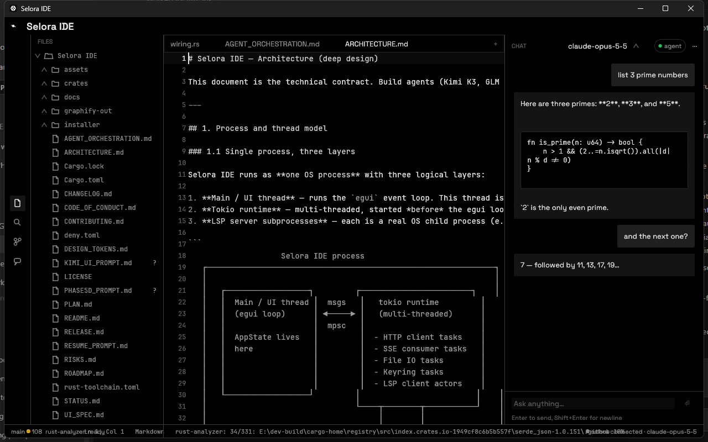
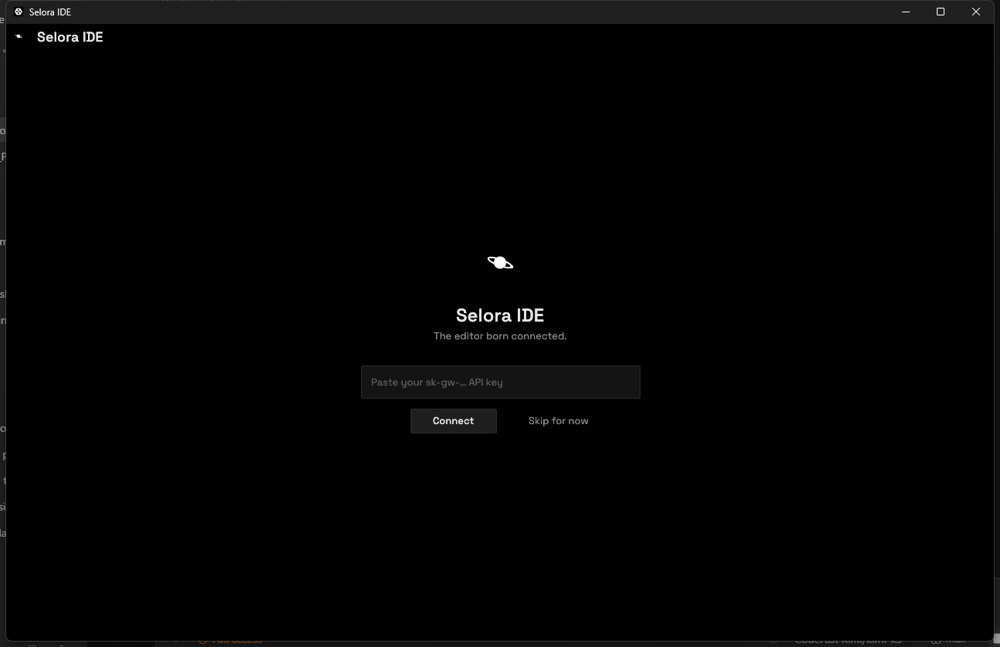
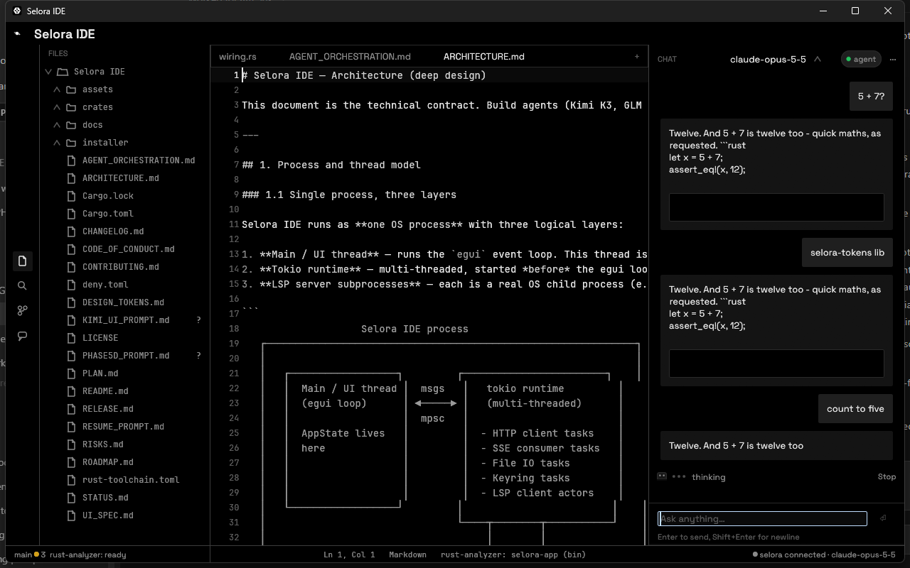
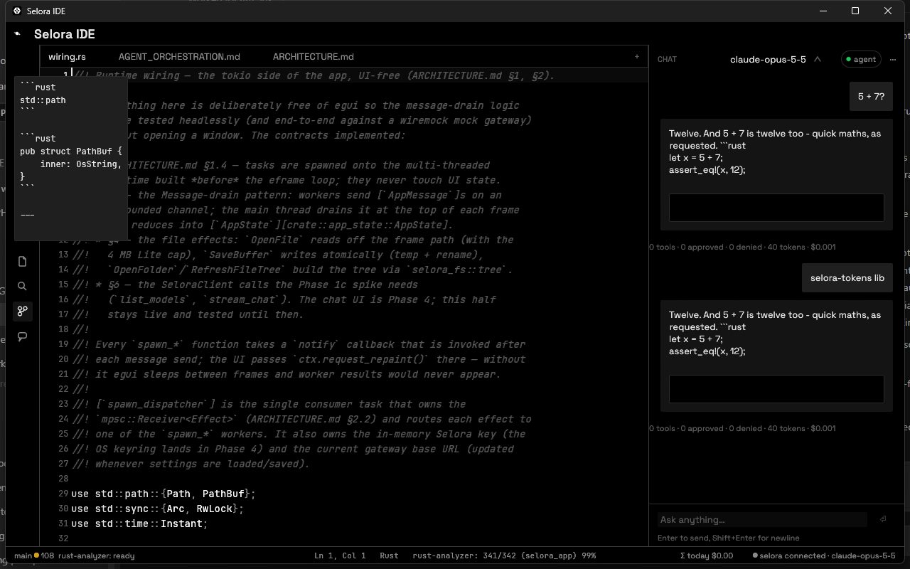
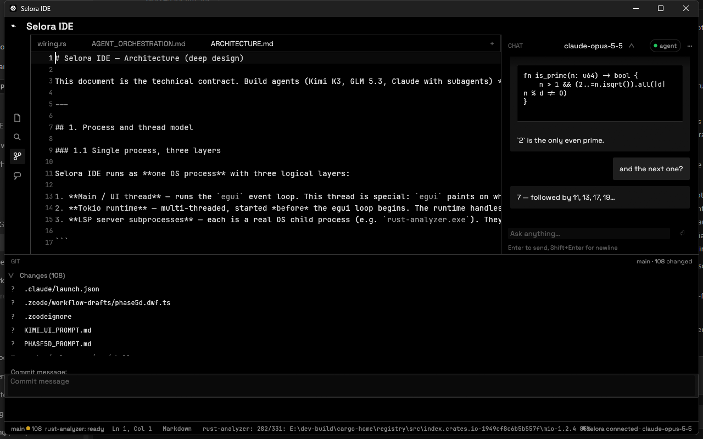
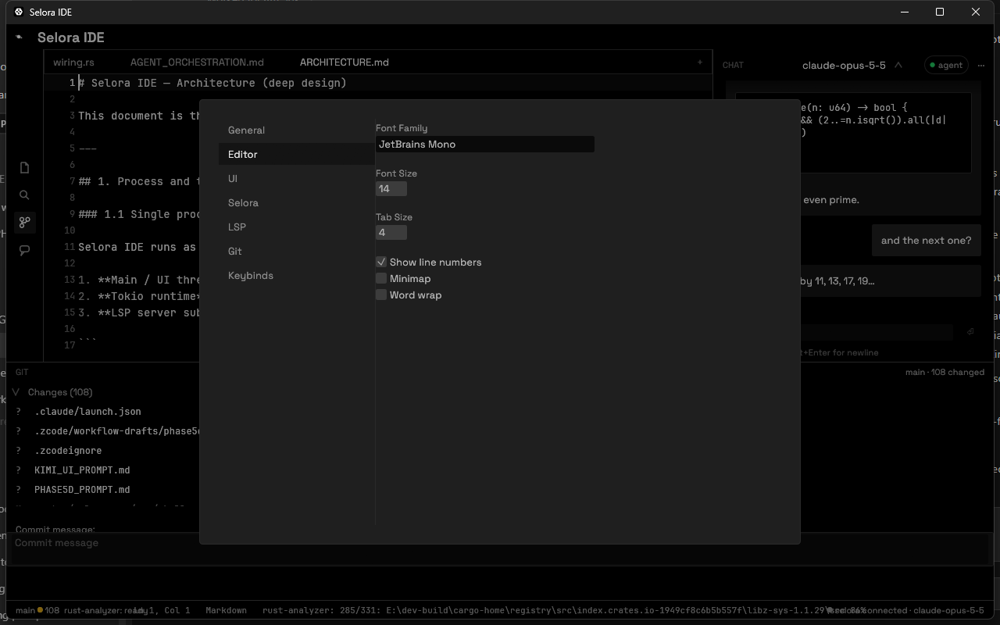
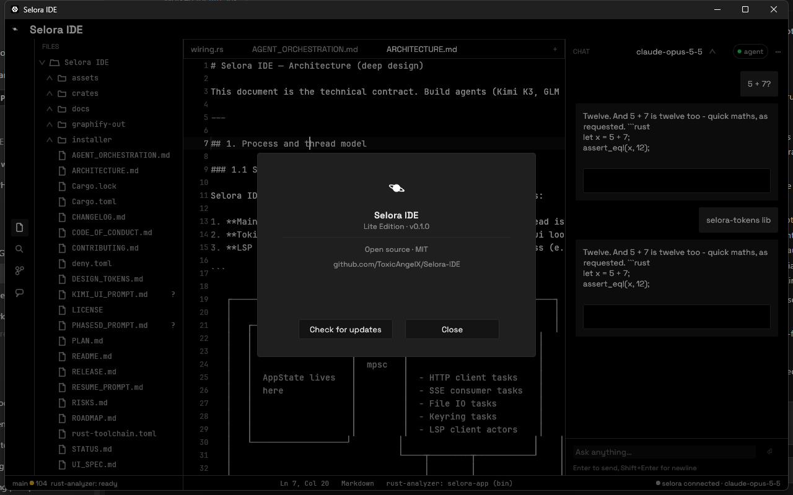

# Selora IDE

**The editor born connected to Selora.**

[](https://github.com/ToxicAngelX/Selora-IDE/actions/workflows/ci.yml)
[](LICENSE)

Selora IDE is an open-source, native-feel code editor written in Rust. Its
chat, inline completions, and agent mode are billed through
[api.selora.lol](https://api.selora.lol) — a first-class AI gateway, not an
afterthought. No API key pasted into a third-party panel, no extension
marketplace between you and the models.

The design language is the Selora brand: monochrome dark, hairline borders,
calm motion, functional green only. The editor pane is custom-rendered on top
of [egui](https://github.com/emilk/egui) — pure Rust, no webview.



<details>
<summary>More screenshots</summary>

| | |
|---|---|
|  |  |
|  |  |
|  |  |

</details>

## Features

- **Editor** — multi-tab, split panes, syntax highlighting (tree-sitter:
  Rust, TypeScript, JavaScript, Python, JSON, TOML, Markdown, HTML, CSS),
  fuzzy file finder (`Ctrl+P`), command palette (`Ctrl+Shift+P`).
- **Language intelligence** — rust-analyzer and typescript-language-server
  over a thin in-house LSP client: hover, go-to-definition, completion,
  diagnostics.
- **Git** — status decorations in the file tree, stage/unstage, commit from
  the panel (`Ctrl+Enter`).
- **Selora AI** — streaming chat sidebar (`Ctrl+L`), model picker with live
  catalog, ghost-text inline completions (Tab to accept), per-model cost
  meter in the status bar.
- **Agent Mode** — the model reads, creates, edits, and deletes workspace
  files, runs shell commands, and searches/fetches the web — every
  side-effecting action gated behind an approval card (diffs in-chat, Deny
  leaves disk untouched). Loop caps: 25 iterations / 10 minutes / $1, all
  configurable.
- **Search** — workspace-wide search (`Ctrl+Shift+F`) over ripgrep when
  available, with a built-in fallback.

## Install

Download `Selora-IDE-Setup-X.Y.Z.exe` from the latest
[GitHub Release](https://github.com/ToxicAngelX/Selora-IDE/releases) and run
it — per-user install, no admin required. First launch shows the splash:
paste your `sk-gw-…` key (or Skip and connect later from the status bar).

## Building from source

Requires Rust stable (MSVC toolchain on Windows). See
[rustup](https://rustup.rs/).

```sh
cargo build --workspace
cargo run -p selora-app
cargo test --workspace
```

Before committing, also run:

```sh
cargo fmt --all
cargo clippy --workspace --all-targets -- -D warnings
```

Bundled fonts (Space Grotesk and JetBrains Mono, both SIL OFL 1.1) are
embedded in the binary — nothing is downloaded at runtime.

To build the Windows installer (Inno Setup 6 required):

```bat
installer\prebuild.bat
```

## Documentation

- [`docs/`](docs/) — the MkDocs sources for the user documentation site.
- [`PLAN.md`](PLAN.md) — the master plan (read this first if contributing).
- [`ARCHITECTURE.md`](ARCHITECTURE.md) — the technical contract.
- [`DESIGN_TOKENS.md`](DESIGN_TOKENS.md) — the visual contract.
- [`UI_SPEC.md`](UI_SPEC.md) — the screen-by-screen layout contract.
- [`ROADMAP.md`](ROADMAP.md) — the phase breakdown and exit gates.
- [`RELEASE.md`](RELEASE.md) — the release runbook.
- [`CONTRIBUTING.md`](CONTRIBUTING.md) — how to contribute (humans and AI
  agents alike; see also [`AGENT_ORCHESTRATION.md`](AGENT_ORCHESTRATION.md)).

## License

MIT (see [LICENSE](LICENSE)). Bundled fonts are SIL OFL 1.1.
